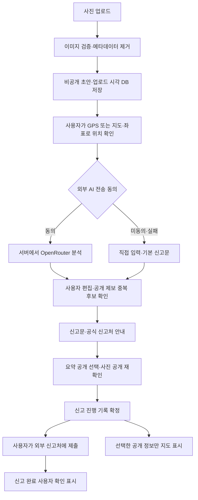

# SafeReport 개발설명서

## 무엇을 해결하나요?

위험한 시설을 발견해도 어디에 어떤 내용으로 신고할지 몰라 지나치는 문제를 줄입니다. 사진으로 기록하고, AI와 함께 설명을 준비하고, 비슷한 앱 제보를 확인한 다음 공식 신고처로 이동할 수 있습니다. 공식 기관에 대신 신고하는 기능은 없습니다.

## 기술을 선택한 이유

- Next.js는 웹 화면과 서버 API를 한 프로젝트에서 만듭니다. TypeScript는 데이터 모양을 검사해 입력 실수를 줄입니다. Python의 타입 힌트와 비슷하지만 빌드 전 검사에 더 적극적으로 사용합니다.
- SQLite는 별도 DB 서버 설치 없이 파일 하나에 저장합니다. Prisma는 코드로 DB를 조회·수정하는 도구입니다. 예를 들어 `db.report.findMany()`는 제보 목록을 읽습니다.
- Leaflet은 지도 화면을 만들고 OpenStreetMap 타일은 지도 배경을 제공합니다. GPS는 AI가 아니라 브라우저 위치 API입니다.
- OpenRouter는 서버가 AI 모델을 호출하는 연결 통로입니다. API 키는 서버의 인증 비밀값이고 브라우저에 전달하지 않습니다. AI 결과가 항상 맞는 것은 아니므로 사람이 편집합니다.
- Tailwind와 공통 CSS로 모바일·PC 디자인을 구성합니다. 서버와 DB를 나눠 운영하는 복잡한 구조는 아직 필요하지 않습니다.

## 시작점과 폴더 관계

`npm run dev` → `scripts/run.mjs` → Next.js → `src/app/layout.tsx` → `src/app/page.tsx` → `src/components/SimpleApp.tsx` 순서로 시작합니다.

`SimpleApp.tsx`의 `api()`가 서버 API를 부르고, `src/app/api/[...segments]/route.ts`의 `handle()`이 요청을 분기합니다. `src/lib/server.ts`가 소유권·DB·AI를 처리하며, `src/lib/rules.ts`가 시간·위치·신고처를 계산합니다. 저장 구조는 `prisma/schema.prisma`에 있습니다. 각 소스 파일 역할은 `src/README.md`와 연결해 확인할 수 있습니다.

## 예시: 깨진 보도블록을 발견한 경우

1. **사진:** `SimpleApp.upload()` → `POST /api/reports/upload`에서 실제 이미지·용량을 검사하고 메타데이터를 제거한 비공개 초안을 저장합니다. `owner(true)`는 브라우저 소유권 쿠키와 해시를 연결합니다.
2. **위치:** GPS 버튼, `LocationSearch`, 지도 클릭 중 하나로 위치를 고릅니다. `pick()`이 좌표를 받고 `save()`가 선택 위치·장소 설명을 저장합니다. 일반 화면에 위험 유형이나 숫자 좌표를 입력할 필요는 없습니다.
3. **상황:** 한 문장 설명을 적고 `compare()`로 유사 제보를 확인합니다. AI 동의가 있으면 `POST /:id/inspect`가 `assistReport(...,false)`로 유형·요약·위험도를 보조하고, `findSimilar()`가 150m 공개 후보 최대 8건을 비교합니다. 동의가 없어도 문구·거리 후보를 볼 수 있습니다.
4. **신고문:** 공식 사이트 링크를 확인하고 `generate()` → `POST /:id/draft` → `assistReport(...,true)`로 제목과 신고 내용을 생성합니다. 사용자가 편집하고 `copy()`로 복사한 뒤 공식 사이트에서 직접 제출합니다. 키가 없거나 AI가 실패하면 직접 작성할 수 있습니다.
5. **보관 선택:** `store()`가 변경된 유사 후보를 다시 확인하고 `publish` API로 내 기록을 확정합니다. 요약 공개와 사진 공개는 별도 선택이고 사진은 두 번째 확인이 필요합니다. 상태 변경은 내 기록의 접힌 관리 메뉴에서 처리합니다.
6. **전국 지도:** ‘위험 지도’를 선택하면 전국 범위와 공개 제보를 바로 표시합니다. `NATIONAL_BOUNDS`가 초기 범위, `riskFilter`가 위험도 필터이며 지역 선택 단계는 없습니다. `Map.preserveView`가 데이터 갱신 시 탐색 위치를 유지하고 ‘전국 보기’는 지도를 초기화합니다.

## 상태와 공개는 다릅니다

| 항목 | 의미 |
|---|---|
| `isDraft` | 사진은 올렸지만 신고 진행을 확정하지 않았는지 |
| `status` | 준비 중 / 신고 완료(사용자 확인) / 신고 미완료 |
| `isPublic` | 다른 사용자의 지도·중복 검색에 요약을 표시하는지 |
| `photoPublic` | 추가 확인 후 사진까지 공개했는지 |

예를 들어 10분이 지난 비공개 초안은 `isDraft=true`, `status=INCOMPLETE`, `isPublic=false`입니다. 시간이 지났다고 자동 공개되거나 삭제되지 않습니다. `effectiveStatus()`와 `normalize()`는 완료를 보존하며 만료를 보정합니다. 만료 보정은 편집 중인 화면의 미저장 입력을 덮어쓰지 않습니다.

## 권한과 개인정보를 어떻게 지키나요?

- `checkOrigin()`은 로컬 브라우저의 동일 출처 요청만 변경 API에 허용합니다.
- `access()`는 본인인지 또는 공개 확정 제보인지 검사합니다. 남의 비공개 ID를 알아도 상세·사진·수정은 거부됩니다.
- `publicReport()`는 정밀 좌표, 내부 사진 경로, 소유자 ID, 개인 신고 초안을 공개하지 않습니다. 모델에게 권한 결정을 맡기지 않습니다.
- 공개 사진도 서버 API를 거쳐 읽습니다. 사진 공개를 철회하면 다음 요청부터 차단됩니다. 이미 다른 사람이 저장한 사본까지 회수할 수는 없습니다.
- 삭제 API는 제보·이력을 제거하고 사진 파일을 삭제합니다. 빈 브라우저 소유자 레코드는 유지됩니다.
- 사진·설명에 개인정보가 없는지는 사용자가 확인합니다. 자동 얼굴 가림과 완전한 익명화는 아직 제공하지 않습니다.

## 검증과 발표

검사 결과는 `PROJECT.md`에 실제 실행한 내용만 기록합니다. 테스트는 `tests/unit`에서 핵심 계산·AI 실패, `tests/e2e`에서 별도 DB와 Chrome으로 API·화면을 검사합니다. `scripts/live-smoke.mjs`는 합성 사진으로 실제 AI와 지도 연결을 확인하고 `evidence`에 증거를 남깁니다. AI 품질 일반화나 실제 기관 접수 성공을 입증하는 검사는 아닙니다.

발표는 **위험을 발견해도 신고가 번거로운 문제 → 사진·위치·AI·신고문 시연 → 화면·서버·DB 구조 → 권한과 중복·만료 핵심 구현 → 실제 검사 결과와 한계 → 운영 전 보완** 순서로 진행하면 됩니다. `신고 완료(사용자 확인)`과 공식 접수 완료를 혼동하지 않도록 설명하세요.

현재 구조를 유지하며 저장·복구, 계정 또는 소유권 복구, 공개 사진 검수·보관 정책, 공유 호출 제한·비용 관리, 운영 지도·HTTPS를 차례로 보완합니다. 구체적인 순서와 확인 방법은 README의 운영 전 보완 항목에 있습니다.

## 추가된 AI 위험 지도

`Report`에 `riskLevel`, `riskReason`, `riskAssessedAt`, `riskModel`을 추가하는 마이그레이션을 적용했습니다. 기존 제보는 삭제하지 않고 `UNKNOWN`에서 시작합니다.

새 제보의 `/analyze`는 기존 분석과 함께 위험도도 저장합니다. 기존 제보에서는 `RiskAssessment`의 별도 동의 후 `POST /:id/risk`가 본인 권한을 검사하고 사진·설명을 모델에 보냅니다. `riskSchema`는 LOW·MEDIUM·HIGH·UNKNOWN만 허용하며 근거 없는 평가나 잘못된 응답은 저장하지 않습니다. AI 실패 시 규칙으로 위험도를 만들어내지 않습니다.

`riskInputChanged()`가 제목·설명·유형·요약·위치를 확인합니다. 관찰 내용이 바뀌면 과거 평가를 지우고 재분석하게 합니다. `publicReport()`는 공개 동의된 제보의 위험도·이유·시각만 공개 데이터에 덧붙입니다. `Map`의 `riskMode`와 `groupRisk()`는 제보 수와 분리해 각 제보의 위험도 중 최댓값을 색으로 표시합니다. 지도·필터 조회에는 AI 비용이 발생하지 않습니다.

예를 들어 같은 위치에 보도블록 파손과 신호등 고장이 있으면 각각 비교해 다른 위험으로 안내할 수 있습니다. 여러 제보가 모두 LOW여도 건수 때문에 HIGH로 바꾸지 않습니다. 신고 완료 상태도 수리나 위험 해소를 뜻하지 않습니다. 합성 사진이나 흐린 사진처럼 근거가 부족하면 UNKNOWN을 유지하는 것이 정상입니다.

## 간편 4단계 화면과 지역 지도

현재 진입점은 `SimpleApp.tsx`입니다. 기존 `Fixit.tsx`와 기존 스타일은 삭제하지 않고 보존했습니다. 사진 → GPS·장소 검색·간단한 장소 설명 → 상황·유사 제보 → 추천 사이트·AI 제목/신고 내용·복사로 진행합니다. 공개·상태 관리는 접힌 선택 항목으로 옮겨 주 작업과 구분했습니다.

`LocationSearch`의 검색 버튼은 `/api/locations?q=...`를 부릅니다. 서버 `searchLocations()`는 한국 결과만 요청하고 초당 1회 제한·캐시·12초 제한을 적용합니다. 검색 결과 선택이 `pick()`에 좌표를 전달합니다. GPS는 별도 브라우저 권한이며 AI 기능이 아닙니다.

지역 지도는 `data/regions.json`의 시·도와 시·군·구를 선택한 뒤 `/api/locations?region=...`에서 범위와 경계를 받습니다. `inRegion()`이 공개 제보를 경계에 맞춰 고르고 `Map.bounds`가 해당 지역으로 화면을 맞춥니다. 미선택·로딩·결과 없음·검색 실패는 각각 구분합니다.

세 번째 화면은 `compare()` → `inspect`(AI 동의 시) → `similar`로 이어지고, 네 번째 화면은 `generate()` → `draft` → `assistReport(...,true)`로 제목과 신고 내용을 생성합니다. 제목을 포함한 사용자의 최종 편집은 보관 전 `save()`로 저장됩니다. AI 결과가 오기 전에 입력이 바뀌면 서버는 409로 거부해 새 입력을 덮어쓰지 않습니다.

실제 신고는 추천 공식 사이트에서 직접 진행합니다. 복사 버튼은 클립보드에 내용을 넣을 뿐 기관에 전송하지 않습니다. 지도에 남기기는 별도 선택이며 새로운 로그인이나 DB 구조 변경은 없습니다.

## 최신 화면 기준: 일반 사용자와 전국 지도

입력 흐름만 짧게 유지하며 특정 연령층을 전제로 하지 않습니다. 안내·오류·동의 문구는 일반 서비스 톤으로 정리하고 기존 시각 디자인은 유지합니다. 위험 지도는 지역 선택 없이 전국 공개 제보를 즉시 표시합니다. 이전 지역 선택 설명은 개발 이력이며 현재 활성 화면에는 적용되지 않습니다. 장소 입력의 GPS·검색과 4단계 흐름, 신고처 안내·제목/신고문 생성·복사는 유지합니다. 지역 관련 파일은 삭제하지 않고 보존했습니다.
